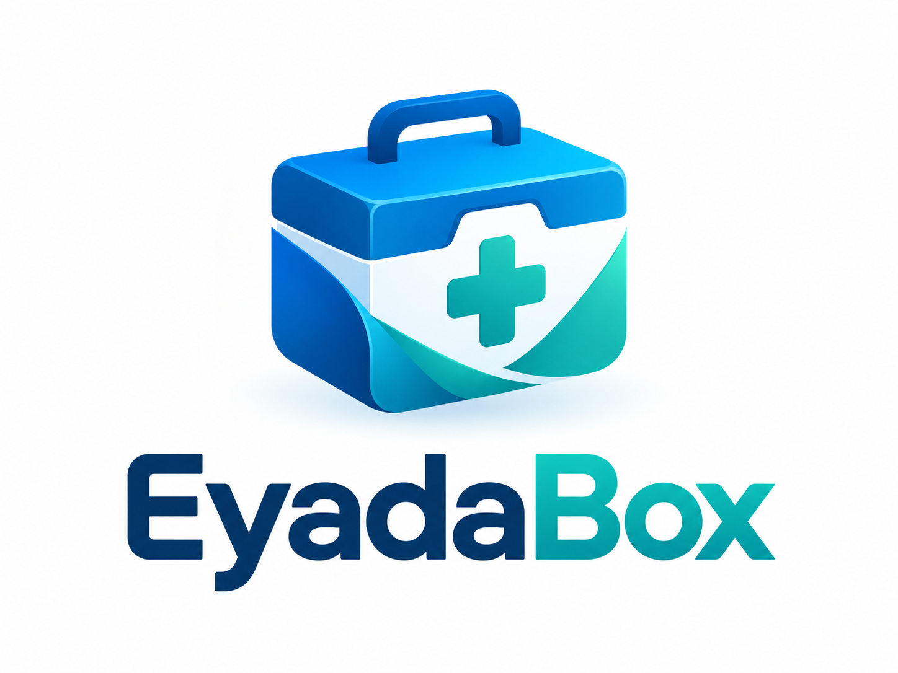

# EyadaBox — Clinic Desk



Clinic Desk is an offline-first desktop workspace for small clinics. It keeps the front-desk workflow focused on patients, appointments, practitioners, and local clinic operations—without requiring a cloud account or a remote database.

Arabic and English interfaces are supported. The product uses the Arabic EyadaBox mark whenever the application language is Arabic and the English mark for all other supported interface languages.

> Status: active development. The application is not yet released for clinic use.

## What is implemented

- Local first-run onboarding for the initial clinic administrator.
- Native local sign-in with memory-only sessions and role-aware access.
- Patient registration, search, editing, profile history, and archive protection.
- Appointment calendar and list views, practitioner filtering, editing, and conflict prevention.
- Practitioner profiles and weekly working hours.
- Clinic settings and local staff metadata management.
- SQLite persistence in the operating-system application-data directory when running as the desktop app.
- Bilingual Arabic/English UI with RTL support.

## Product principles

- **Offline by default** — no cloud service, remote database, or telemetry is required.
- **Simple for reception** — common actions stay close to the calendar and patient record.
- **Safe local access** — passwords are processed in Rust with Argon2id; React never receives a password hash.
- **Clear boundaries** — UI components call feature services, while database and native behavior remain behind typed feature APIs.

## Technology

| Layer | Technology |
| --- | --- |
| Interface | React 19, TypeScript, Vite, Tailwind CSS v4 |
| Desktop runtime | Tauri 2 and Rust |
| Local data | SQLite with migrations |
| Localization | i18next with Arabic RTL and English |
| Authentication | Native Tauri commands, Argon2id, in-memory session |

## First-run experience

1. Install and open the desktop application.
2. Clinic Desk opens the setup screen on a fresh device.
3. Create the first local administrator account.
4. Sign in to reach the clinic workspace.

Sessions are cleared when the desktop application closes. There is no public sign-up flow or cloud recovery flow in the current release scope.

## Development

### Prerequisites

- Node.js `20.19+` or `22.12+`
- npm
- Rust stable toolchain and the Windows C++ build prerequisites for Tauri development

### Run the browser interface

```bash
npm install
npm run dev
```

The browser runtime is useful for UI development. Secure local authentication intentionally requires the installed Tauri desktop runtime, so browser mode displays a native-runtime notice instead of simulating a sign-in.

### Run the desktop development app

```bash
npm run tauri:dev
```

The desktop runtime creates and uses its SQLite database in the operating-system application-data directory.

## Project structure

```text
src/
  features/        Domain types, validation, repositories, and services
  pages/Clinic/    Clinic routes and screens
  components/      Reusable UI and feature components
  locales/         Arabic and English translations
  lib/             Runtime and database helpers
src-tauri/
  migrations/      SQLite schema migrations
  src/             Tauri commands and native authentication
docs/
  tasks/           Product decisions and implementation records
```

## Documentation

- [Architecture](docs/architecture.md)
- [Project rules](docs/PROJECT_RULES.md)
- [Database and migrations](docs/tasks/02-database-and-migrations.md)
- [Local authentication and onboarding](docs/tasks/08-local-auth-and-onboarding.md)
- [Windows release and installation](docs/tasks/07-windows-release-and-installation.md)

## Release policy

The debug executable is for local development only and must not be shared with clinics. A user-facing Windows installer is produced only from an explicitly requested, reviewed Tauri release build. See the [release guide](docs/tasks/07-windows-release-and-installation.md) for the distribution path and validation checklist.

## License and template attribution

Clinic Desk is built from the TailAdmin React template. Preserve any upstream license notices that apply to the template and its bundled assets.
